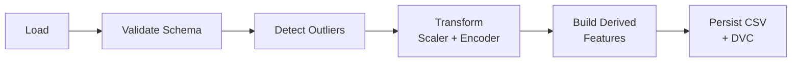
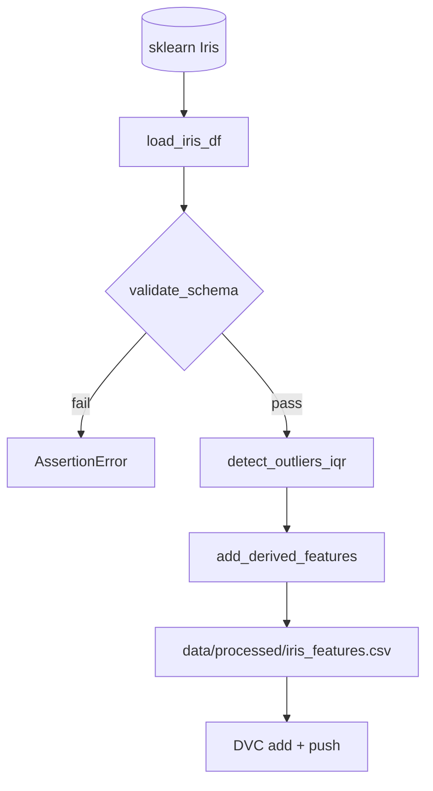

# 🏗️ Arquitetura — Aula 02: Feature Engineering

A **Aula 02** estende o pipeline da Aula 01 com **validação de dados**, **transformações** e **features derivadas**.

---

## 🎯 Visão Geral



| Etapa | Responsabilidade | Arquivo |
|-------|------------------|---------|
| **Load** | Carregar dataset como DataFrame | `src/data/load.py` |
| **Validate** | Schema + outliers | `src/data/validate.py` |
| **Transform** | Normalização + encoding | `src/features/transform.py` |
| **Build** | Features derivadas | `src/features/build.py` |
| **Pipeline** | Orquestra tudo | `src/pipeline.py` |

---

## 📁 Estrutura de Diretórios

```
fiap-ml-aula02/
├── .gitignore
├── README.md
├── requirements.txt
├── pytest.ini
├── docs/
│   ├── ARCHITECTURE.md
│   ├── CHEATSHEET.md
│   ├── HANDS-ON-02-01.md     # Validação
│   ├── HANDS-ON-02-02.md     # Transformação
│   └── HANDS-ON-02-03.md     # Features derivadas + DVC
├── src/
│   ├── data/
│   │   ├── load.py
│   │   └── validate.py
│   ├── features/
│   │   ├── transform.py
│   │   └── build.py
│   └── pipeline.py
├── tests/
│   ├── test_validate.py
│   ├── test_transform.py
│   └── test_build.py
└── data/
    └── processed/             # CSV gerado (gitignored, versionado via DVC)
```

---

## 🔄 Fluxo de Dados



---

## 🧱 Decisões de Design

### 1. Schema explícito
`EXPECTED_SCHEMA` é dict — fonte única da verdade sobre colunas/tipos esperados.

### 2. Outliers detectados, não removidos
No Iris, outliers são pétalas naturalmente diferentes. **Logamos** para auditoria, mas não removemos automaticamente.

### 3. Transformações como Pipeline sklearn
Permite serializar todo o pré-processamento em UM objeto (`joblib.dump(pipeline, ...)`).

### 4. Features derivadas determinísticas
`sepal_area = sepal_length × sepal_width`. Sem aleatoriedade → reprodutível.

### 5. DVC para versionamento de saídas
Dataset processado é "artefato" — versionado fora do Git para escalar.

---

## 🆚 Antes vs Depois (Aula 01 → 02)

| Aspecto | Aula 01 | Aula 02 |
|---------|---------|---------|
| Dados | `sklearn.load_iris(return_X_y=True)` | DataFrame com colunas nomeadas |
| Validação | Asserções básicas (`len`, `NaN`) | Schema explícito + outliers |
| Features | 4 features originais | 4 originais + 4 derivadas |
| Persistência | Só modelo (.pkl) | Modelo + dataset processado (DVC) |

---

## 🚀 Próximo Passo

Aula 03 vai usar o `iris_features.csv` gerado aqui como **input** do treinamento com MLflow.
