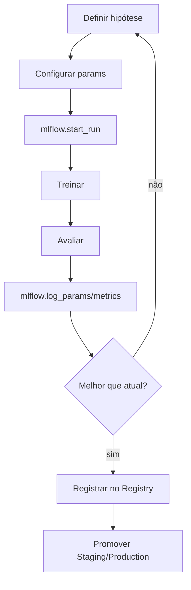

# 🏗️ Arquitetura — Aula 03: Treinamento e Validação

A **Aula 03** adiciona ao pipeline: **divisão treino/teste**, **métricas robustas**, **MLflow** e **hyperparameter tuning**.

---

## 🎯 Visão Geral


| Etapa | Responsabilidade | Arquivo |
|-------|------------------|---------|
| **Split** | Treino/teste estratificado | `src/train/split.py` |
| **Métricas** | Accuracy, P, R, F1, Matriz | `src/train/metrics.py` |
| **Overfitting** | Demo de overfitting por profundidade | `src/train/demo_overfit.py` |
| **Treino** | Treinar e logar no MLflow | `src/train/train_mlflow.py` |
| **Cross Val** | K-Fold CV | `src/train/cross_val.py` |
| **Tuning** | Grid/Random Search | `src/train/tuning.py` |
| **Optuna** | Tuning inteligente | `src/train/optuna_tuning.py` |

---

## 📁 Estrutura de Diretórios

```
fiap-ml-aula03/
├── .gitignore
├── README.md
├── requirements.txt
├── pytest.ini
├── docs/
│   ├── ARCHITECTURE.md
│   ├── CHEATSHEET.md
│   ├── HANDS-ON-03-01.md     # Métricas e Overfitting
│   ├── HANDS-ON-03-02.md     # MLflow
│   └── HANDS-ON-03-03.md     # Tuning
├── src/
│   └── train/
│       ├── split.py
│       ├── metrics.py
│       ├── demo_overfit.py
│       ├── train_mlflow.py
│       ├── cross_val.py
│       ├── tuning.py
│       └── optuna_tuning.py
├── tests/
│   ├── test_split.py
│   └── test_metrics.py
└── mlruns/                    # MLflow tracking (gitignored)
```

---

## 🔄 Ciclo do Experimento ML



---

## 🧱 Decisões de Design

### 1. Split estratificado
`stratify=y` garante distribuição de classes igual em treino e teste — crítico para datasets desbalanceados.

### 2. MLflow local (filesystem)
`./mlruns/` armazena tudo. Em produção, usar backend SQL + S3/MinIO (fora de escopo).

### 3. Métricas weighted
`average="weighted"` em precision/recall calcula média ponderada pela frequência da classe — robusto a desbalanceamento.

### 4. Reprodutibilidade
`random_state=42` em todos os componentes: split, modelo, search.

### 5. Tuning incremental
Grid → Random → Optuna. Cada um mais eficiente que o anterior.

---

## 🆚 Analogia DevOps

| MLflow | Container Registry |
|--------|---------------------|
| Experiment | Repositório de imagens |
| Run | Build |
| Run ID | Build hash |
| Model Registry | Tags de imagem |
| `Production` stage | Tag `prod` |

---

## 🚀 Próximo Passo

A Aula 04 vai **carregar o modelo de `Production`** do MLflow Registry e servir via API REST + Docker.
