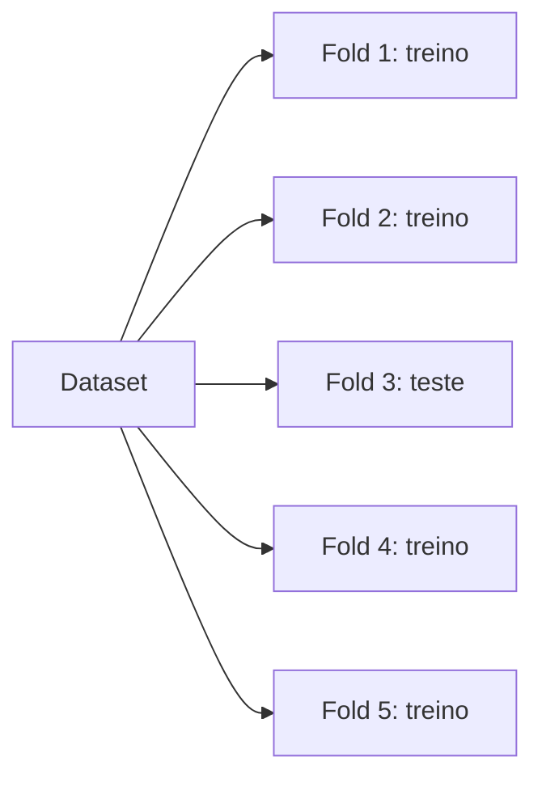

# 🎬 Vídeo 3.3 - Validação Cruzada e Hyperparameter Tuning

**Aula**: 3 - Treinamento de Modelos e Validação  
**Vídeo**: 3.3  
**Temas**: K-Fold Cross Validation; GridSearch; RandomSearch; Optuna

---

## 🚀 Sobre Este Vídeo

> **"Testar `n_estimators=10, 50, 100, 200...` na mão é trabalho braçal. Bora automatizar."**

### O que você vai fazer:

| Etapa | Descrição |
|-------|-----------|
| **K-Fold CV** | Aumentar confiança da métrica |
| **GridSearchCV** | Testar todas combinações |
| **RandomSearchCV** | Amostragem aleatória (mais rápido) |
| **Optuna** | Otimização inteligente |

### Os 3 métodos de tuning, lado a lado

| Método | Como escolhe as combinações | Velocidade | Quando usar |
|--------|------------------------------|------------|-------------|
| **Grid Search** | Testa TODAS as combinações da lista | 🐢 Lento | Poucos parâmetros e poucos valores |
| **Random Search** | Sorteia N combinações aleatórias | 🐇 Rápido | Muitos parâmetros, quer um bom resultado rápido |
| **Optuna** | Aprende com as tentativas e escolhe a próxima de forma esperta | ⚡ Eficiente | Quer o melhor resultado com menos tentativas |

### Pré-requisitos

| Requisito | Como verificar |
|-----------|----------------|
| Vídeo 3.2 concluído | MLflow rodando |
| Optuna instalado | `pip install optuna` |
| Modelo registrado | `iris-classifier v1` em Production |

---

## 📚 Parte 1: Por Que Cross Validation?

### Passo 1: O Problema do Single Split

```
Split A: treino → accuracy = 0.95
Split B: treino → accuracy = 0.88
Split C: treino → accuracy = 0.92
```

Qual é a "verdadeira" accuracy? Depende do split!

> 💡 **Ponto-chave**: Cross Validation = treinar **K vezes** com splits diferentes e tirar a **média**. Métrica mais confiável.

---

### Passo 2: K-Fold em Ação



Em K=5, o modelo é treinado 5 vezes, cada vez com 1 fold diferente como teste.

> 🔁 **O que é K-Fold:** em vez de testar o modelo uma única vez (e correr o risco de ter pego um split "de sorte" ou "de azar"), o K-Fold divide os dados em K partes iguais — aqui K=5. Depois treina 5 vezes: em cada rodada, 4 partes servem de treino e 1 parte fica de fora pra teste, sempre revezando qual parte é o teste. No final você tem 5 notas e tira a média.
>
> Por que isso importa: a média de 5 testes é muito mais confiável do que uma nota única, porque não depende de qual fatia dos dados caiu no teste. É a diferença entre tirar uma conclusão de uma prova só ou da média de cinco provas.

---

### Passo 3: Executar K-Fold

**Criar `src/train/cross_val.py`:**

```python
"""Cross validation."""
import logging
import numpy as np
from sklearn.ensemble import RandomForestClassifier
from sklearn.model_selection import cross_val_score
from sklearn.datasets import load_iris

logger = logging.getLogger(__name__)


def cross_validate(model, k=5):
    """Retorna scores de K-Fold CV."""
    X, y = load_iris(return_X_y=True)
    scores = cross_val_score(model, X, y, cv=k, scoring="accuracy")

    logger.info(f"K-Fold (k={k}) scores: {scores.round(3)}")
    logger.info(f"Média: {scores.mean():.3f} ± {scores.std():.3f}")
    return scores


if __name__ == "__main__":
    logging.basicConfig(level=logging.INFO)
    model = RandomForestClassifier(n_estimators=100, random_state=42)
    cross_validate(model)
```

**Executar:**

**Linux/Mac e Windows:**
```bash
PYTHONPATH=src python src/train/cross_val.py
```

> 🧠 **O que esse comando faz:** `PYTHONPATH=src` diz ao Python "procure os módulos dentro da pasta `src`". O resto roda o script de K-Fold.
>
> 🔁 **K-Fold explicado simples:** em vez de testar o modelo UMA vez (e torcer pra ter dado sorte no split), o K-Fold corta os dados em K pedaços (aqui K=5). Treina 5 vezes, cada vez usando um pedaço diferente como teste e os outros 4 como treino. No fim tira a média. Assim a métrica é mais confiável, porque não depende de um único split de sorte.

**Resultado esperado:**
```
INFO: K-Fold (k=5) scores: [0.967 0.967 0.933 0.967 1.   ]
INFO: Média: 0.967 ± 0.022
```

> 📊 **Como ler:** os 5 números são a nota de cada rodada. A média (0.967) é a performance "real" esperada. O `± 0.022` é o desvio padrão — quanto MENOR, mais estável o modelo. Você não quer só a média boa, quer também baixa variação entre as rodadas.

> 💡 **Leitura**: Accuracy média é 0.967, com desvio de 0.022. Modelo é **consistente** entre folds.

✅ Cross validation rodando.

---

## 🔍 Parte 2: Grid Search

### Passo 4: Definir o Grid

**Adicionar a `src/train/tuning.py`:**

```python
"""Hyperparameter tuning."""
import logging
import mlflow
from sklearn.ensemble import RandomForestClassifier
from sklearn.model_selection import GridSearchCV
from sklearn.datasets import load_iris

logger = logging.getLogger(__name__)


def grid_search(experiment_name="iris-tuning"):
    """Roda GridSearchCV e loga no MLflow."""
    mlflow.set_experiment(experiment_name)

    X, y = load_iris(return_X_y=True)

    param_grid = {
        "n_estimators": [50, 100, 200],
        "max_depth": [3, 5, 10, None],
        "min_samples_split": [2, 5],
    }
    # Total: 3 × 4 × 2 = 24 combinações

    with mlflow.start_run(run_name="grid_search"):
        search = GridSearchCV(
            estimator=RandomForestClassifier(random_state=42),
            param_grid=param_grid,
            cv=5,
            scoring="accuracy",
            n_jobs=-1,  # paraleliza
        )
        search.fit(X, y)

        logger.info(f"Melhores params: {search.best_params_}")
        logger.info(f"Melhor score: {search.best_score_:.3f}")

        # Logar no MLflow
        mlflow.log_params(search.best_params_)
        mlflow.log_metric("best_cv_score", search.best_score_)
        mlflow.sklearn.log_model(search.best_estimator_, "model")

        return search.best_estimator_, search.best_params_


if __name__ == "__main__":
    logging.basicConfig(level=logging.INFO)
    grid_search()
```

---

### Passo 5: Executar Grid Search

**Linux/Mac e Windows:**
```bash
PYTHONPATH=src python src/train/tuning.py
```

> ⚙️ **Grid Search = força bruta organizada.** Você dá uma lista de valores pra cada hiperparâmetro e ele testa TODAS as combinações possíveis, escolhendo a melhor. Cobre tudo, mas custa caro: quanto mais valores, mais treinos (e mais demorado).

**Resultado esperado:**
```
INFO: Melhores params: {'max_depth': 3, 'min_samples_split': 2, 'n_estimators': 50}
INFO: Melhor score: 0.967
```

> ⚠️ **CUIDADO**: Grid de 24 × 5 folds = **120 treinos**. Em datasets grandes, isso pode levar horas.

✅ Grid Search concluído.

---

## 🎲 Parte 3: Random Search

### Passo 6: Mais Rápido, Quase Tão Bom

**Adicionar a `src/train/tuning.py`:**

```python
from sklearn.model_selection import RandomizedSearchCV
from scipy.stats import randint


def random_search(n_iter=20):
    """RandomSearchCV: amostragem aleatória do espaço."""
    X, y = load_iris(return_X_y=True)

    param_dist = {
        "n_estimators": randint(10, 300),
        "max_depth": randint(2, 20),
        "min_samples_split": randint(2, 10),
    }

    with mlflow.start_run(run_name="random_search"):
        search = RandomizedSearchCV(
            estimator=RandomForestClassifier(random_state=42),
            param_distributions=param_dist,
            n_iter=n_iter,
            cv=5,
            scoring="accuracy",
            random_state=42,
            n_jobs=-1,
        )
        search.fit(X, y)

        logger.info(f"Random - Melhores params: {search.best_params_}")
        logger.info(f"Random - Score: {search.best_score_:.3f}")

        mlflow.log_params(search.best_params_)
        mlflow.log_metric("best_cv_score", search.best_score_)

        return search.best_estimator_
```

**Executar:**

**Linux/Mac e Windows:**
```bash
PYTHONPATH=src python -c "
import logging
logging.basicConfig(level=logging.INFO)
from train.tuning import random_search
random_search(n_iter=20)
"
```

> 💡 **Por que o `logging.basicConfig`?** A função `random_search` mostra o resultado via `logger.info()`. Sem essa linha, o Python esconde mensagens de nível INFO e nada aparece na tela — foi por isso que o comando "não trouxe nada".

> 🎲 **Random Search = amostragem.** Em vez de testar tudo, sorteia N combinações (aqui 20) dentro de faixas que você define. Geralmente já encontra um resultado bom o suficiente numa fração do tempo do Grid Search.

**Resultado esperado:**
```
INFO: Random - Melhores params: {'max_depth': 7, 'min_samples_split': 3, 'n_estimators': 142}
INFO: Random - Score: 0.967
```

> 💡 **Ponto-chave**: Random Search com **20 iterações** geralmente atinge resultado próximo ao Grid Search com 120 — em **1/6 do tempo**.

✅ Random Search concluído.

---

## 🤖 Parte 4: Optuna (Tuning Inteligente)

### Passo 7: O Que É Optuna?

**Grid Search**: testa tudo. Cego.  
**Random Search**: testa aleatório. Sorte.  
**Optuna**: aprende com tentativas anteriores. **Inteligente.**

> 💡 Optuna usa um algoritmo chamado **TPE** (Tree-structured Parzen Estimator). Você não precisa entender — só usar.

---

### Passo 8: Instalar e Configurar

**Linux/Mac:**
```bash
pip install optuna
```

**Windows (PowerShell):**
```powershell
pip install optuna
```

**Resultado esperado:** `Successfully installed optuna-3.4.0`

---

### Passo 9: Otimizar com Optuna

**Criar `src/train/optuna_tuning.py`:**

```python
"""Hyperparameter tuning com Optuna."""
import logging
import optuna
import mlflow
import numpy as np
from sklearn.ensemble import RandomForestClassifier
from sklearn.model_selection import cross_val_score
from sklearn.datasets import load_iris

logger = logging.getLogger(__name__)


def objective(trial):
    """Função-objetivo: Optuna minimiza/maximiza isto."""
    n_estimators = trial.suggest_int("n_estimators", 10, 300)
    max_depth = trial.suggest_int("max_depth", 2, 20)
    min_samples_split = trial.suggest_int("min_samples_split", 2, 10)

    model = RandomForestClassifier(
        n_estimators=n_estimators,
        max_depth=max_depth,
        min_samples_split=min_samples_split,
        random_state=42,
    )

    X, y = load_iris(return_X_y=True)
    score = cross_val_score(model, X, y, cv=5, scoring="accuracy").mean()
    return score


def run_optuna(n_trials=30):
    """Roda otimização e loga no MLflow."""
    mlflow.set_experiment("iris-optuna")

    study = optuna.create_study(direction="maximize")
    study.optimize(objective, n_trials=n_trials)

    logger.info(f"Optuna - Melhores params: {study.best_params}")
    logger.info(f"Optuna - Score: {study.best_value:.3f}")

    with mlflow.start_run(run_name="optuna_best"):
        mlflow.log_params(study.best_params)
        mlflow.log_metric("best_cv_score", study.best_value)

    return study


if __name__ == "__main__":
    logging.basicConfig(level=logging.INFO)
    optuna.logging.set_verbosity(optuna.logging.WARNING)
    run_optuna()
```

---

### Passo 10: Executar e Comparar

**Linux/Mac e Windows:**
```bash
PYTHONPATH=src python src/train/optuna_tuning.py
```

> 🤖 **Optuna = busca que aprende.** Grid e Random são "cegos" — não usam o que já descobriram. O Optuna olha os resultados das tentativas anteriores e escolhe a próxima combinação de forma mais esperta (algoritmo TPE — trate como caixa-preta). Com isso chega a um bom resultado com menos tentativas.

**Resultado esperado:**
```
INFO: Optuna - Melhores params: {'n_estimators': 87, 'max_depth': 4, 'min_samples_split': 3}
INFO: Optuna - Score: 0.973
```

**Comparação:**

| Método | Iterações | Score | Tempo relativo |
|--------|-----------|-------|----------------|
| Grid Search | 24 × 5 = 120 | 0.967 | 1.0x |
| Random Search | 20 × 5 = 100 | 0.967 | 0.8x |
| **Optuna** | **30 × 5 = 150** | **0.973** ⭐ | **1.2x** |

Optuna encontrou um modelo **ligeiramente melhor** com poucas tentativas adicionais.

✅ Tuning automático concluído.

---

## 🔧 Troubleshooting

| Erro | Causa | Solução |
|------|-------|---------|
| Grid Search trava o computador | `n_jobs=-1` usa todos os cores | Reduzir para `n_jobs=2` |
| `ModuleNotFoundError: scipy.stats` | Não instalado | `pip install scipy` |
| Optuna não loga no MLflow | Esqueceu de envolver em `with mlflow.start_run()` | Adicionar context manager |
| Score estagnado em todas tentativas | Search space muito pequeno | Ampliar ranges (ex: `randint(2, 50)`) |
| `RuntimeError: dictionary changed size` | Optuna paralelizado com pandas mutável | Não usar globals mutáveis em `objective` |

---

**FIM DO VÍDEO 3.3** ✅

---

## 🏆 Recapitulação da Aula 03

| Vídeo | O que aprendeu |
|-------|---------------|
| **3.1** | Train/test split, overfitting, métricas |
| **3.2** | MLflow Tracking + Model Registry |
| **3.3** | Cross validation, Grid/Random/Optuna |

**Próxima aula:** Deploy do modelo (API REST + Docker) 🚀
