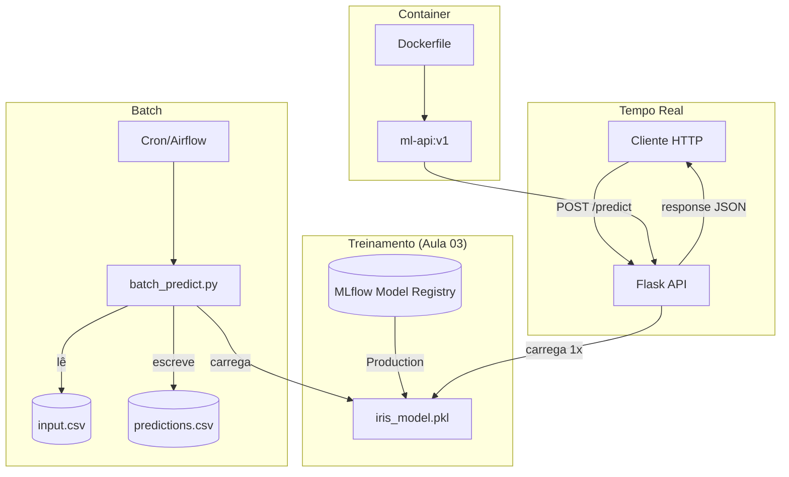

# 🏗️ Arquitetura — Aula 04: Deploy de Modelos

A **Aula 04** transforma o modelo treinado (Aula 03) em **artefato deployável**: batch script + API REST containerizada.

---

## 🎯 Visão Geral



---

## 📁 Estrutura de Diretórios

```
fiap-ml-aula04/
├── .gitignore
├── .dockerignore
├── README.md
├── requirements.txt
├── pytest.ini
├── Dockerfile                 # Imagem padrão
├── Dockerfile.slim            # Multi-stage (menor)
├── docker-compose.yml         # API + MLflow
├── docs/
│   ├── ARCHITECTURE.md
│   ├── CHEATSHEET.md
│   ├── HANDS-ON-04-01.md      # Batch
│   ├── HANDS-ON-04-02.md      # Flask API
│   └── HANDS-ON-04-03.md      # Docker
├── src/
│   ├── train.py               # Treina e salva modelo
│   ├── batch_predict.py       # Predição em lote
│   └── api/
│       └── app.py             # Flask API
├── tests/
│   ├── test_api.py
│   └── test_batch.py
├── models/                    # iris_model.pkl (gitignored)
└── data/                      # CSVs de input/output (gitignored)
```

---

## 🆚 Comparação dos Padrões

| Aspecto | Batch | Tempo Real |
|---------|-------|------------|
| **Arquivo** | `src/batch_predict.py` | `src/api/app.py` |
| **Trigger** | CLI (`python batch_predict.py`) | HTTP POST `/predict` |
| **Modelo carregado** | A cada execução | Uma vez no startup |
| **Volume** | Milhares de linhas por execução | 1 predição por request |
| **Latência aceitável** | Minutos a horas | Milissegundos |
| **Estado** | Stateless | Stateful (modelo em memória) |

---

## 🧱 Decisões de Design

### 1. Modelo carregado no startup
Em API, `joblib.load()` na inicialização. **Nunca** a cada request — mata performance.

### 2. Validação de input retorna 400
JSON malformado ou campos faltando → HTTP 400 com mensagem. Nunca deixar virar 500.

### 3. Health check separado
`/health` independente do modelo. Permite Kubernetes/load balancer fazer liveness check sem custo.

### 4. .dockerignore minimalista
Sem `.dockerignore`, build copia `venv/`, `__pycache__/`, `.git/` — tudo entra no contexto e fica lento.

### 5. Multi-stage build
Stage 1 instala dependências, Stage 2 só copia o que precisa para rodar. Reduz imagem ~20%.

### 6. Porta 5001 (não 5000)
macOS Sonoma+ usa porta 5000 para AirPlay. Padrão do curso: **5001**.

---

## 🚀 Próximo Passo

Aula 05 vai **orquestrar** o pipeline batch usando Apache Airflow, e a Aula 08 fará deploy automático da imagem Docker via CI/CD.
