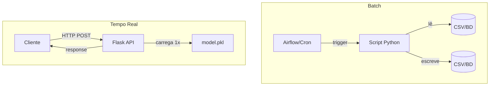

# 🎬 Vídeo 4.1 - Padrões de Deploy: Batch vs Tempo Real

**Aula**: 4 - Deploy de Modelos  
**Vídeo**: 4.1  
**Temas**: Batch Processing; Real-time Inference; Trade-offs; Quando usar cada um

---

## 🚀 Sobre Este Vídeo

> **"Antes de codar deploy, decisão arquitetural: batch ou tempo real? Isso muda TUDO."**

### O que você vai fazer:

| Etapa | Descrição |
|-------|-----------|
| **Batch** | Implementar predição em lote (CSV) |
| **Tempo real** | Conhecer a estrutura de API REST |
| **Comparação** | Tabela de trade-offs |
| **Decisão** | Escolher padrão por caso de uso |

### Pré-requisitos

| Requisito | Como verificar |
|-----------|----------------|
| Aula 03 concluída | Modelo no MLflow Registry |
| Python 3.9+ | `python3 --version` |
| Modelo treinado | `models/model.pkl` ou Registry |

---

## 📚 Parte 1: Os Dois Padrões

### Passo 1: Comparação Direta

| Aspecto | Batch | Tempo Real |
|---------|-------|------------|
| **Trigger** | Agendado (cron, Airflow) | Request HTTP |
| **Latência** | Minutos a horas | Milissegundos |
| **Volume** | Milhões de registros | 1 por vez |
| **Custo** | Baixo (compute on-demand) | Alto (sempre disponível) |
| **Complexidade** | Baixa | Alta |
| **Exemplos** | Score de crédito diário | Detecção de fraude, recomendação |

> 💡 **Ponto-chave**: 80% dos problemas de ML em empresa **não precisam** de tempo real. Batch é mais simples e barato.

---

### Passo 2: Quando Usar Cada Um?

**Use BATCH quando:**
- ✅ Resultado pode esperar (relatório semanal, score diário)
- ✅ Tem muitos dados pra processar de uma vez
- ✅ Quer economizar custo (não precisa servidor 24/7)

**Use TEMPO REAL quando:**
- ✅ Decisão precisa ser imediata (< 1s)
- ✅ Cada request é único e imprevisível
- ✅ Sistema externo (e-commerce, chatbot) consome

---

## 🛠️ Parte 2: Setup do Projeto

### Passo 3: Estrutura

**Linux/Mac:**
```bash
mkdir -p ~/fiap-mlops/aula04
cd ~/fiap-mlops/aula04
python3 -m venv venv
source venv/bin/activate
pip install scikit-learn pandas joblib flask
```

**Windows (PowerShell):**
```powershell
New-Item -ItemType Directory -Path "$HOME\fiap-mlops\aula04" -Force
cd "$HOME\fiap-mlops\aula04"
python -m venv venv
.\venv\Scripts\Activate.ps1
pip install scikit-learn pandas joblib flask
```

**Resultado esperado:** `Successfully installed flask-3.0.0 scikit-learn-1.3.0 ...`

✅ Ambiente pronto.

---

### Passo 4: Treinar e Salvar Modelo

**Criar `src/train.py`:**

```python
"""Treina e salva modelo para deploy."""
import joblib
from pathlib import Path
from sklearn.datasets import load_iris
from sklearn.ensemble import RandomForestClassifier
from sklearn.model_selection import train_test_split

X, y = load_iris(return_X_y=True)
X_train, X_test, y_train, y_test = train_test_split(X, y, test_size=0.2, random_state=42)

model = RandomForestClassifier(n_estimators=100, random_state=42).fit(X_train, y_train)
print(f"Accuracy: {model.score(X_test, y_test):.3f}")

Path("models").mkdir(exist_ok=True)
joblib.dump(model, "models/iris_model.pkl")
print("💾 Modelo salvo em models/iris_model.pkl")
```

> 🧠 **Entendendo o lado ML**: o que estamos "buildando" aqui não é um binário, é um **artefato estatístico**. O `RandomForestClassifier` ajusta seus parâmetros nos dados de treino (`fit`) e o `joblib.dump` serializa o objeto Python inteiro (a floresta de árvores já treinada) num `.pkl`. Dois detalhes que importam pro deploy:
> - **`random_state=42`**: fixa a aleatoriedade do treino. É o equivalente a um build determinístico — sem isso, dois treinos geram modelos diferentes.
> - **`stratify=y`**: garante que treino e teste tenham a mesma proporção das 3 classes. Sem isso, o `accuracy` (sua "métrica de qualidade do build") fica enviesado e não confiável.

**Executar:**

**Linux/Mac:**
```bash
mkdir -p src models data
python src/train.py
```

**Windows (PowerShell):**
```powershell
New-Item -ItemType Directory -Path src, models, data -Force
python src\train.py
```

**Resultado esperado:**
```
Accuracy: 0.967
💾 Modelo salvo em models/iris_model.pkl
```

✅ Modelo treinado.

---

## 🔄 Parte 3: Implementar Batch

### Passo 5: Gerar Dados de Entrada

**Criar `data/input.csv`:**

```csv
sepal_length,sepal_width,petal_length,petal_width
5.1,3.5,1.4,0.2
6.7,3.1,4.4,1.4
6.3,3.3,6.0,2.5
4.9,3.0,1.4,0.2
5.8,2.7,5.1,1.9
```

**Linux/Mac:**
```bash
cat > data/input.csv << 'EOF'
sepal_length,sepal_width,petal_length,petal_width
5.1,3.5,1.4,0.2
6.7,3.1,4.4,1.4
6.3,3.3,6.0,2.5
4.9,3.0,1.4,0.2
5.8,2.7,5.1,1.9
EOF
```

**Windows (PowerShell):**
```powershell
@"
sepal_length,sepal_width,petal_length,petal_width
5.1,3.5,1.4,0.2
6.7,3.1,4.4,1.4
6.3,3.3,6.0,2.5
4.9,3.0,1.4,0.2
5.8,2.7,5.1,1.9
"@ | Out-File -FilePath data\input.csv -Encoding utf8
```

✅ Dados de entrada prontos.

---

### Passo 6: Script de Predição em Batch

**Criar `src/batch_predict.py`:**

```python
"""Predição em batch: lê CSV, prediz, salva CSV."""
import argparse
import logging
import joblib
import pandas as pd
from pathlib import Path

logging.basicConfig(level=logging.INFO, format="%(asctime)s | %(message)s")
logger = logging.getLogger("batch")

CLASSES = {0: "setosa", 1: "versicolor", 2: "virginica"}


def predict_batch(input_path: str, output_path: str, model_path: str):
    """Lê CSV, prediz e salva."""
    logger.info(f"Carregando modelo de {model_path}")
    model = joblib.load(model_path)

    logger.info(f"Lendo entrada: {input_path}")
    df = pd.read_csv(input_path)
    logger.info(f"   {len(df)} linhas para processar")

    # Predizer
    predictions = model.predict(df.values)
    probas = model.predict_proba(df.values).max(axis=1)

    # Anexar resultado
    df["prediction"] = predictions
    df["class_name"] = [CLASSES[p] for p in predictions]
    df["confidence"] = probas.round(3)

    # Salvar
    Path(output_path).parent.mkdir(parents=True, exist_ok=True)
    df.to_csv(output_path, index=False)
    logger.info(f"💾 Resultados salvos em {output_path}")
    return df


if __name__ == "__main__":
    parser = argparse.ArgumentParser()
    parser.add_argument("--input", default="data/input.csv")
    parser.add_argument("--output", default="data/predictions.csv")
    parser.add_argument("--model", default="models/iris_model.pkl")
    args = parser.parse_args()

    df = predict_batch(args.input, args.output, args.model)
    print(df.to_string(index=False))
```

> 🧠 **Entendendo o lado ML**: o modelo prediz por **posição de coluna**, não por nome (`df.values`). Se o CSV vier com as 4 colunas fora de ordem, a predição sai errada e **não levanta exceção** — é o "silent failure" da versão ML. Em pipeline de produção, vale validar o schema do CSV (ordem e nome das colunas) antes de chamar o `predict`, do mesmo jeito que você validaria um payload de entrada.

---

### Passo 7: Executar Batch

**Linux/Mac:**
```bash
python src/batch_predict.py
```

**Windows (PowerShell):**
```powershell
python src\batch_predict.py
```

**Resultado esperado:**
```
2026-06-26 10:00:00 | Carregando modelo de models/iris_model.pkl
2026-06-26 10:00:00 | Lendo entrada: data/input.csv
2026-06-26 10:00:00 |    5 linhas para processar
2026-06-26 10:00:00 | 💾 Resultados salvos em data/predictions.csv

 sepal_length  sepal_width  petal_length  petal_width  prediction  class_name  confidence
          5.1          3.5           1.4          0.2           0      setosa       1.00
          6.7          3.1           4.4          1.4           1  versicolor       0.97
          6.3          3.3           6.0          2.5           2   virginica       1.00
          4.9          3.0           1.4          0.2           0      setosa       1.00
          5.8          2.7           5.1          1.9           2   virginica       0.85
```

✅ Predição em batch funcionando.

---

### Passo 8: Verificar Saída

**Linux/Mac:**
```bash
cat data/predictions.csv
```

**Windows (PowerShell):**
```powershell
Get-Content data\predictions.csv
```

**Resultado esperado:**
```
sepal_length,sepal_width,petal_length,petal_width,prediction,class_name,confidence
5.1,3.5,1.4,0.2,0,setosa,1.0
6.7,3.1,4.4,1.4,1,versicolor,0.97
...
```

✅ CSV de saída gerado.

---

## ⚡ Parte 4: Preview de Tempo Real

### Passo 9: Por que Batch não basta?

**Cenário e-commerce:**
> Cliente clica em "Comprar". Sistema precisa decidir em **200ms** se é fraude. **Batch noturno não serve.**

Próximo vídeo: API REST com Flask para servir o modelo via HTTP.

---

### Passo 10: Arquitetura Comparada



| Decisão | Batch | Tempo Real |
|---------|-------|------------|
| Modelo carregado | A cada execução | Uma vez no startup |
| Latência | Não importa | Crítica |
| Escalabilidade | Vertical (máquina maior) | Horizontal (mais containers) |

✅ Você sabe escolher entre batch e tempo real.

---

## 🔧 Troubleshooting

| Erro | Causa | Solução |
|------|-------|---------|
| `FileNotFoundError: models/iris_model.pkl` | Modelo não treinado | Rodar `python src/train.py` primeiro |
| `KeyError` ao ler CSV | Coluna faltando | Verificar header do CSV |
| Predição com erro de shape | Número de features errado | CSV precisa ter exatamente 4 colunas |
| `JoblibException` ao carregar | Versão do sklearn diferente | Treinar e carregar com mesma versão |
| Encoding UTF-8 (Windows) | PowerShell salvou em UTF-16 | Usar `Out-File -Encoding utf8` |

---

**FIM DO VÍDEO 4.1** ✅
