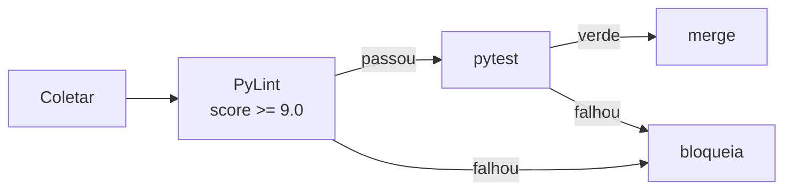

# 🎬 Vídeo 6.3 - Qualidade com PyLint e cProfile

**Aula**: 6 - SOLID, Reprodutibilidade e Qualidade de Código    
**Vídeo**: 6.3  
**Temas**: PyLint; Padronização; cProfile; Profiling de performance

---

## 🚀 Sobre Este Vídeo

> **"Código que roda não é o suficiente. Tem que ser legível (PyLint) e rápido onde importa (cProfile)."**

### O que você vai fazer:

| Etapa | Descrição |
|-------|-----------|
| **PyLint** | Rodar, ler o score, configurar `.pylintrc`, zerar warnings |
| **Antes/depois** | Comparar a nota do código monolítico com o pipeline SOLID |
| **cProfile** | Perfilar o treino e ler `pstats` |
| **Gargalo** | Identificar onde o tempo é gasto |

### Pré-requisitos

| Requisito | Como verificar |
|-----------|----------------|
| Vídeos 6.1 e 6.2 concluídos | `src/ml_pipeline/` + `scripts/` existem |
| Ambiente virtual ativo | `which python` aponta para o `venv` |
| PyLint instalado | `pylint --version` |

---

## 🧰 Parte 0: Ambiente Virtual

### Passo 0: Ativar o venv

Os comandos deste vídeo (`pylint`, `radon`) vêm do `requirements.txt` — só funcionam
com o venv ativo:

**Linux/Mac:**
```bash
source venv/bin/activate     # se ainda não criou: python3.11 -m venv venv && pip install -r requirements.txt
```

**Windows (PowerShell):**
```powershell
.\venv\Scripts\Activate.ps1
```

> ⚠️ Sem o venv ativo aparece `command not found: pylint`. O prompt deve mostrar `(venv)`.

---

## 📚 Parte 1: PyLint

### Passo 1: Rodar no Código Ruim

```bash
pylint src/before/train_monolitico.py
```

**Resultado esperado (resumido):**
```
R0914: Too many local variables (22/15)
R0912: Too many branches (25/12)
R0915: Too many statements (60/50)
Your code has been rated at 8.73/10
```

> 🔍 **Nos bastidores**: o score do PyLint é uma fórmula sobre a contagem de mensagens
> por categoria (Convention, Refactor, Warning, Error), normalizada por número de
> instruções. Repare que mesmo um código ruim tira nota alta se for "limpo na
> superfície" — os avisos que importam aqui são os **R** (refactor): `too-many-branches`
> e `too-many-statements` são o PyLint apontando a mesma complexidade que o `radon`
> mediu no 6.1, por outro ângulo.

---

### Passo 2: Rodar no Código Refatorado

```bash
pylint src/ml_pipeline/
```

**Resultado esperado:**
```
Your code has been rated at 10.00/10
```

| Alvo | Score PyLint |
|------|--------------|
| `src/before/train_monolitico.py` | 8.73/10 (com 3 avisos de refactor) |
| `src/ml_pipeline/` | **10.00/10** |

---

### Passo 3: Entender o `.pylintrc`

O arquivo `.pylintrc` na raiz configura o linter para o projeto. Trechos-chave:

```ini
[MESSAGES CONTROL]
disable=
    missing-module-docstring,
    too-few-public-methods

[DESIGN]
max-args=6
max-locals=15
max-branches=12

[FORMAT]
max-line-length=100

[MAIN]
ignore=archive
```

> 🔍 **Nos bastidores**: desabilitar mensagem é uma decisão de equipe, não preguiça.
> `missing-module-docstring` é ruído num projeto pequeno e didático, então some com ele.
> Já os limites de `[DESIGN]` (`max-branches`, `max-locals`) são os mesmos thresholds
> que reprovaram o código monolítico — deixá-los explícitos transforma "código complexo"
> em **erro de CI**, não em opinião. `ignore=archive` evita lintar o material legado.

---

### Passo 4: Demonstrar um Warning (Demo)

> 🧪 **Mudança temporária de demonstração.** Adicione um import não usado em
> `src/ml_pipeline/pipeline.py`:

```python
import os  # <- linha temporária só pra demo
```

```bash
pylint src/ml_pipeline/pipeline.py
```

**Resultado esperado:** `W0611: Unused import os (unused-import)` e o score cai de 10.

> ↩️ **Reverter**: remova o `import os`. O pipeline final fica em 10.00/10.

---

## ⚡ Parte 2: cProfile

### Passo 5: Perfilar o Treino

`scripts/profile_training.py` roda a função `train()` sob o `cProfile` e imprime as funções
por tempo cumulativo.

**Linux/Mac:**
```bash
PYTHONPATH=. python scripts/profile_training.py --top 6
```

**Windows (PowerShell):**
```powershell
$env:PYTHONPATH = "."
python scripts/profile_training.py --top 6
```

**Resultado esperado (resumido):**
```
354175 function calls in 0.118 seconds
   Ordered by: cumulative time

   ncalls  tottime  cumtime  filename:lineno(function)
        1    0.000    0.128  pipeline.py:13(train)
        1    0.000    0.092  _forest.py:302(fit)
```

> 🔍 **Nos bastidores**: as colunas que importam são `tottime` (tempo **só** dentro
> da função, sem chamadas filhas) e `cumtime` (tempo incluindo filhas). Ordenando por
> `cumulative`, o topo é sempre o `train`; o interessante é descer até encontrar a
> primeira função com `tottime` alto — é ali que está o trabalho real. Aqui é o
> `_forest.py:fit` (treino do RandomForest), que é esperado. Otimizar antes de
> perfilar é chutar no escuro.

---

### Passo 6: Salvar para Visualização

**Linux/Mac:**
```bash
PYTHONPATH=. python scripts/profile_training.py --dump train.prof
```

**Windows (PowerShell):**
```powershell
$env:PYTHONPATH = "."
python scripts/profile_training.py --dump train.prof
```

Isso gera `train.prof`, que pode ser aberto num visualizador interativo (igual nos dois sistemas):

```bash
pip install snakeviz
snakeviz train.prof
```

> ⚠️ `snakeviz` abre um servidor web (longa duração) — rode em terminal separado.
> O arquivo `*.prof` está no `.gitignore`; não commite.

---

### Passo 7: Interpretar o Gargalo

No resultado acima, o trabalho real está em `_forest.py:fit` (o treino do RandomForest).
Num projeto Iris isso é rápido e esperado. Em um caso real, o gargalo costuma aparecer
em outro lugar — leitura de arquivo repetida, um `apply` linha a linha, uma chamada de
rede dentro de loop.

> 🔍 **Nos bastidores**: a regra é **medir antes de otimizar**. Se uma função tivesse,
> por exemplo, um `time.sleep` ou um loop ineficiente na limpeza, ela apareceria no topo
> com `cumtime` alto, dominando o tempo total — e o profiler apontaria exatamente onde
> mexer. Otimizar sem perfilar é chutar no escuro: você gasta esforço onde não dói.

---

## 🔁 Parte 3: Integrar no Fluxo

### Passo 8: PyLint + pytest no CI

A ideia de qualidade contínua: o CI roda lint e testes juntos e quebra o build se
qualquer um falhar.

```bash
pylint src/ml_pipeline/ --fail-under=9.0
pytest
```



> 🔍 **Nos bastidores**: `--fail-under` transforma o score num **gate** binário (exit
> code ≠ 0 reprova o job). Combinado com os limites de `[DESIGN]` do `.pylintrc`, isso
> impede que a complexidade que você acabou de remover no 6.1 volte sorrateiramente
> num PR futuro.

---

## 🔧 Troubleshooting

| Erro | Causa | Solução |
|------|-------|---------|
| `pylint: command not found` | Não instalado | `pip install pylint` |
| PyLint linta o `archive/` | Sem ignore | `ignore=archive` no `.pylintrc` |
| Score baixo por linha longa | `max-line-length` | Ajustar `[FORMAT]` ou quebrar a linha |
| cProfile mostra só o `train` | `--top` muito baixo | Aumentar `--top` para descer na pilha |
| `snakeviz` não abre | Servidor headless | Use `--dump` e abra noutra máquina |

---

**FIM DO VÍDEO 6.3** ✅

---

## 🏆 Recapitulação da Aula 06

| Vídeo | O que aprendeu |
|-------|---------------|
| **6.1** | SOLID: refatorar reduz complexidade ciclomática (D→A) e habilita testes |
| **6.2** | Reprodutibilidade: seeds + MLflow Model Registry (binário ↔ código ↔ deps) |
| **6.3** | Qualidade: PyLint como gate de CI + cProfile para achar gargalos |

**Próxima aula:** continuação do ciclo de MLOps 🔄
